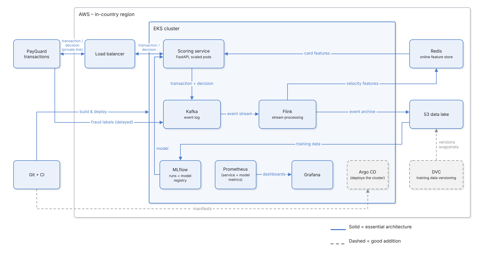

# Memo

**To:** Chief Technology Officer, PayGuard  
**From:** Solutions Architect, Stixor  
**Date:** 26 November 2026  
**Subject:** Production design for the fraud-scoring prototype

**Recommendation.** We recommend taking the fraud-scoring service to production in phases, starting in shadow mode with no effect on payments. On a held-out 12-hour window of your transactions, with alerts capped at an assumed 0.2% of traffic, the model caught 82 of 115 frauds and 66% of their value at a threshold fixed in advance (96 alerts, 14 false). It answered within 26 ms at p99 against a 50 ms limit, and served scores matched offline exactly. The evidence rests on 48 hours of anonymised data, and the threshold drifts between night and day. Velocity features and a steady label feed are the largest gains, and both depend on your team (see final section).

## System architecture

Scoring stays synchronous: each authorisation travels over a private link to a load balancer and a pool of scoring pods on EKS. The pods read the card's velocity features from Redis and return a decision within the 50 ms limit. Nothing else sits in that path.

Everything else runs alongside it:

- **Kafka** (self-hosted on EKS) records every transaction, decision and delayed fraud label, partitioned by card token.
- **Flink** turns that stream into velocity features in Redis and archives events to **S3**, the training source.
- **MLflow** registers each retrained model with its threshold, so every decision traces to one model and one cut.
- **Prometheus and Grafana** watch service and model metrics (next section).

Scoring scales horizontally with single-threaded pods. Our replay showed why: with default threading, overlapping requests competed for every core and p99 latency reached ~22 s. At 4× real traffic without overlap, p99 was 26 ms. A load test at your peak volume comes before launch.

Git and CI test every change, including a check that served scores match offline scores, before deploying through staging. Argo CD (GitOps deploys) and DVC (training-data versioning) are recommended additions, not prerequisites.

## Data: privacy, residency, retention

**Residency.** Every component except Git + CI runs in one in-country AWS region, and organisation-wide policies (SCP region-deny, Control Tower guardrails) block resources or replication anywhere else. The model is a small file served by our own pods, so no transaction is ever sent to an outside model API. The Git repository holds code, not customer data. If no AWS region exists in-country, the same design runs on AWS Outposts or on-premises Kubernetes, because Kafka, Flink, Redis and MLflow are all portable.

**Privacy.**

| Principle | How it's applied (example tools) |
|---|---|
| Private networking | No workload is reachable from the internet; your systems connect over a private link (private subnets, PrivateLink / Direct Connect, security groups, Network Firewall) |
| Encryption | All data is encrypted in transit and at rest, with keys you control (TLS, KMS, Secrets Manager) |
| Least privilege | Every service and person gets only the access their job needs (IAM roles per service, IAM Identity Center + MFA, Kubernetes RBAC) |
| Audit | Every access, deployment, model and decision can be traced (CloudTrail, Git history, MLflow) |
| Minimisation | The platform sees card tokens, never card numbers, and only the fields the model needs (tokenisation at ingestion, field allow-lists) |
| PCI DSS | Built to PCI DSS controls; tokenisation and segmentation keep scope small (segmented subnets and accounts, AWS Config) |

**Retention.** Data is kept for your legal minimum, then deleted: Kafka holds days, and S3 holds the rest on cheaper storage tiers until lifecycle rules delete it.

## Monitoring: what breaks silently

Service health (p99 latency against the 50 ms limit, errors, pod count) is standard Prometheus alerting. The dangerous failures are those where the service keeps answering, but wrongly:

| Silent failure | How it shows | How we catch it |
|---|---|---|
| Threshold drift | The alert rate moves off budget; in our data, a night-set threshold flagged half the budget by day | Hourly alert rate against a budget band; scheduled recalibration |
| Input drift | Score and feature distributions move away from training | Daily drift job (PSI) → Grafana |
| Upstream feature change | Scores look normal but mean something else | Range and null checks at the API; the drift job |
| Stale velocity features | Flink falls behind; pods read old velocity counts | Flink lag and feature-age metrics |
| New fraud patterns | Recall falls, visible only when chargebacks arrive weeks later | Weekly recall and value caught per label cohort; analyst outcomes as an early signal |

Recalibration and retraining go through the same CI and staging path as code.

## Phased rollout

| Phase | What happens | Model work | Move on when |
|---|---|---|---|
| **0. Shadow** | Every authorisation is scored and logged; decisions are unused. | Recalibrate the threshold on live traffic; Flink starts building velocity features. | p99 ≤ 50 ms at peak; alert rate on budget by day and night; parity holds. |
| **1. Human in the loop** | Alerts go to analysts, capped at their capacity; analysts decide every action. | Analyst outcomes as early labels; velocity features, time-of-day handling and forward-chaining validation, each tested against the live model. | Analyst-confirmed precision meets the agreed target; workload sustainable. |
| **2. Partial automation** | The top-score band is auto-actioned (step-up check or decline) on a small traffic share first; analysts keep the rest. | SHAP explanations if the regulator requires them; anomaly score in the analyst queue. | Automated-band precision holds at each step; false declines and complaints within agreed limits. |
| **3. Steady state** | Full traffic; analysts handle the middle band. | Retraining paced by label delay; new models run in shadow before promotion. | n/a |

Phases move on gates, not dates. Any phase rolls back with a Git change: the model and threshold are configuration.

## What we need from PayGuard

| From | What we need | What it unlocks |
|---|---|---|
| Data engineering | Card token, transaction ID, merchant and channel on every authorisation; definitions of any upstream feature transformation | Velocity features, deduplication, Kafka partitioning; no training-serving skew |
| | A chargeback feed and its typical delay | Labels; retraining cadence |
| Fraud operations | Analyst review capacity; the cost of a missed fraud against a false alert; targets for precision, false declines and complaints | The real alert budget, set on cost and capacity (replacing our assumed 0.2%); rollout gates |
| Payments | Peak traffic volume; the fallback when scoring times out; whether step-up checks are supported | Load test and sizing; phase 2 actions |
| IT / platform | Current skills in Kafka, Flink, Redis and EKS; a private link from the payment switch | Who runs what, and what training is needed |
| Compliance | Retention periods, PCI DSS scope, explanation requirements; confirmation of an in-country AWS region | Retention rules, phase 2 design, residency |
