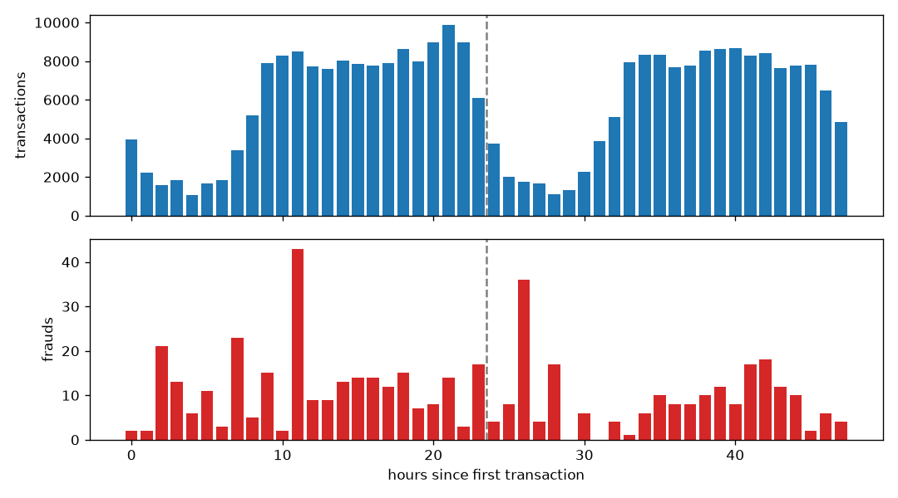
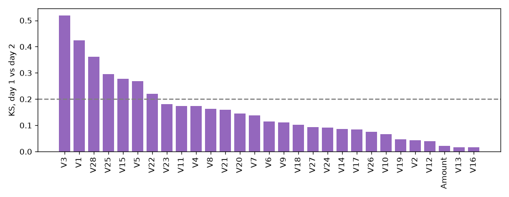
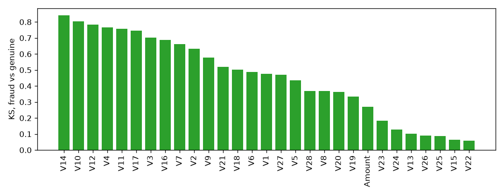
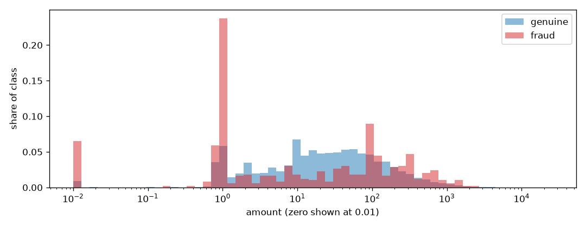

# Data Understanding: Client Card Transactions
Generated by `scripts/fraud/data_understanding.py`. Data SHA-256 `76274b69…a89`.
284,807 transactions over 48 hours, 492 frauds (0.173%).

## Summary
- Day 2 holds **211 frauds** (0.151%) against 281 (0.194%) on day 1, so a day-2 test set has about 211 positives. In the 14 quietest hours fraud runs at **4.3x** the rate of busier hours.
- **1,081 exact duplicate rows** (19 of them fraud), none with conflicting labels. A further 8,063 rows repeat another transaction's values at a different second.
- **7 features shift between the two days** among genuine transactions alone (largest: V3, KS 0.52), so a time split tests something a random split hides.
- **7 features each separate fraud strongly on their own** (KS above 0.7, led by V14, V10, V12).
- **37% of frauds are for 1.00 or less**, against 11% of genuine transactions, yet fraud's 75th-99th percentiles are higher. Amount alone separates weakly.

## 1. Fraud over time

| Day | Transactions | Frauds | Fraud rate |
|---|---|---|---|
| 1 | 144,786 | 281 | 0.194% |
| 2 | 140,021 | 211 | 0.151% |

Volume follows a daily cycle with two quiet stretches. Fraud does not follow volume: in the 14 hours with under
half the median hourly volume, the fraud rate is 0.561% against 0.131% elsewhere. With about
211 frauds on day 2, each caught fraud is worth 0.5% of recall, so model differences of a
few frauds are within noise.

**Feeds:** evaluation framework (split design, test-set size, whether confidence intervals are needed).

## 2. Duplicates
| | Rows |
|---|---|
| Extra copies of an identical row (same second) | 1,081 |
| ...of which fraud | 19 |
| Identical rows with different labels | 0 |
| Same values as another row, different second | 8,063 |

Exact copies share the same second, so they always fall on the same side of a time split and cannot leak between train
and test. They still weight those transactions more in training and evaluation. The repeats at different seconds may be
recurring payments or retries, which are genuine live events, so removing them would train on data unlike production.

**Feeds:** evaluation framework (duplicate policy, decided together with the split).

## 3. Drift between day 1 and day 2

KS statistic per feature, comparing day 1 with day 2 for genuine transactions only, so a change in fraud share can't
cause it (0 = same distribution, 1 = no overlap). 7 features are above 0.2: V3, V1, V28, V25, V15, V5, V22.
A model trained on day 1 meets a slightly different population on day 2, as it would in production. A random split mixes
both days into training and would overstate live performance.

**Feeds:** evaluation framework (time split over random split).

## 4. Which features separate fraud

KS statistic per feature, comparing fraud with genuine transactions. 7 features are above 0.7
(V14, V10, V12, V4, V11, V17, V3), and 7 are below 0.2. Strong single-feature signals mean a simple model
is a credible baseline, and any more complex model has to show it gains beyond them. This is a one-feature-at-a-time
view: it doesn't show how features combine.

**Feeds:** model shortlist (strength of the simple baseline).

## 5. Amount

| | 25% | Median | 75% | 99% | ≤ 1.00 | Zero |
|---|---|---|---|---|---|---|
| Genuine | 5.65 | 22.00 | 77.05 | 1,016.97 | 10.7% | 1,798 |
| Fraud | 1.00 | 9.25 | 105.89 | 1,357.43 | 36.8% | 27 |

Fraud splits into many very small charges and higher 75th-99th percentiles than genuine transactions, so the median alone
(lower for fraud) is misleading. Amount is unscaled and spans several orders of magnitude, so models sensitive to scale
need a log or similar transform, in the shared preprocessing path. Amount is the only field that could cost a missed
fraud in money.

**Feeds:** preprocessing (scaling), evaluation framework (whether evaluation can be weighted by amount).
